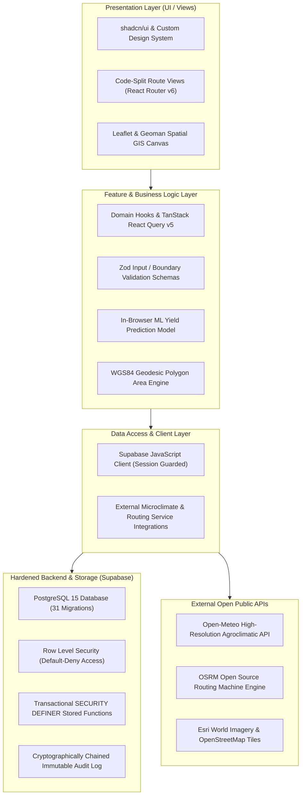

# 🌾 AgroDirect (FarmDirect Hub)
### Next-Generation Precision Agriculture B2B Marketplace & Automated Agronomic Intelligence Platform

[](https://github.com/abirthe/farmdirect-hub)
[-success.svg)](https://github.com/abirthe/farmdirect-hub)
[](https://github.com/abirthe/farmdirect-hub)
[](https://www.typescriptlang.org/)
[](https://react.dev/)
[](https://vitejs.dev/)
[](https://supabase.com/)
[](https://tailwindcss.com/)
[](LICENSE)

---

## 📌 Executive Overview

**AgroDirect (FarmDirect Hub)** is an enterprise-grade digital agriculture infrastructure platform designed to bridge the trust and efficiency deficit between smallholder/commercial farmers and institutional food buyers. 

Traditional agricultural commodity supply chains in South Asia suffer from high middleman margins (up to 15–25%), opaque quality grading, spot price volatility, lack of credit access, and delayed dispute settlements. AgroDirect eliminates these frictions by uniting **satellite earth observation**, **machine learning yield forecasting**, **IoT soil telemetry**, **bKash MFS automated escrow contracts**, and **cryptographically verifiable provenance** into a unified web application.

---

## 🏗️ System Architecture

AgroDirect is constructed using a strict **Feature-Sliced Architecture** adhering to unidirectional data flow:



---

## 🚀 Role-Based Platform Capabilities

### 👨‍🌾 1. For Smallholder & Commercial Farmers
* **Interactive Parcel Boundary Mapping**: Map farmland boundaries directly on high-resolution satellite basemaps (Esri Imagery, OpenTopoMap) with Leaflet-Geoman polygon tools.
* **Geodesic Telemetry HUD**: Live polygon calculation of total hectares, acres, square meters, and South Asian *bigha* units using spherical excess on the WGS84 ellipsoid.
* **AI Yield Prediction**: Ingests parcel size, satellite NDVI, planting duration, and microclimate to forecast ripe crop volume (kg/tons) and optimal harvest dates.
* **IoT Hardware Pairing & Live Telemetry**: Pair hardware sensors (`SOIL_PROBE_NPK`, `WEATHER_STATION`, `LEAF_WETNESS_SENSOR`) and ingest live NPK, soil moisture, and pH telemetry.
* **Precision Agronomy Prescriptions**: Automated engine evaluates sensor logs and prescribes actionable irrigation schedules, NPK top-dressings, and fungal disease treatments.
* **Bilateral Forward Contracts & RFQs**: Browse buyer procurement tenders, submit competitive bids, and lock forward harvest contracts to hedge against spot price crashes.
* **Digital Credit & Insurance Passport**: Generate an underwriting dossier featuring an agricultural credit score (300–850), risk tiering (`AAA` to `HIGH_RISK`), loan limit, and SHA-256 seal.

### 🏢 2. For Institutional Buyers & Food Aggregators
* **Transparent Spot Marketplace**: Search, filter, and inspect verified crop listings by crop type, regional agricultural belt, and spot price floor.
* **AI Smart Sourcing Engine**: Algorithmic recommendations prioritizing high-confidence harvests with verified satellite health and zero broker markups.
* **Reverse Auction Tender Board (RFQ)**: Broadcast procurement requirements with quantity, target price, delivery deadlines, and review verified bids.
* **Escrow Purchase Protection**: Fund orders securely into escrow with bKash Mobile Financial Services (MFS) integration, dynamic platform fees, and refund protection.
* **3PL Logistics Tracking**: Track live transit shipments with OSRM driving geometries, real-time route waypoints, carrier details, and estimated time of arrival (ETA).
* **Spend Analytics & Supplier Rankings**: Track total procurement expenditures, top supplied crops, and supplier delivery performance ratings.

### 🏛️ 3. For Platform Administrators & Compliance Officers
* **Automated KYC/KYB Identity Verification Queue**: Real-time screening queue for National IDs, cadastral land deeds, and trade licenses with automated rule flags.
* **AI-Assisted Dispute Triage**: Automated dispute triage engine cross-referencing buyer claims with historical satellite NDVI scores, fungal disease hazard indices, and delivery timestamps.
* **Dynamic Escrow Fee Tier Management**: Real-time configuration of basis-point fee tiers with min/max caps based on transaction volume brackets.
* **bKash MFS Escrow Settlement**: Verify customer transaction IDs (TrxID), approve fund releases to farmer wallets upon physical handover, or issue escrow refunds.
* **Immutable Audit Trail Explorer**: Complete chronological ledger of platform actions, financial state transitions, and identity reviews with SHA-256 hash validation.

### 🛒 4. For Retail Consumers
* **Batch Provenance & QR Traceability**: Scan batch QR codes or enter order identifiers to review public transparency passports.
* **Farm-to-Fork Verification**: Inspect origin farm GPS coordinates, farmer identity, sowing/harvest dates, and satellite vegetation vigor indices.
* **Freshness Index**: Automated calculation of harvest-to-table freshness decay rating and cryptographic proof-of-delivery trust badges.

---

## 🧠 Deep Dive: AI & Automated Platform Algorithms

AgroDirect replaces manual intermediaries with deterministic, auditable machine learning and automated algorithms:

```
┌────────────────────────────────────────────────────────────────────────────────┐
│                           AGRODIRECT AUTOMATION SUITE                          │
├──────────────────────────┬─────────────────────────────┬───────────────────────┤
│ Algorithm / Engine       │ Input Parameters            │ Primary Output        │
├──────────────────────────┼─────────────────────────────┼───────────────────────┤
│ ML Yield Prediction      │ NDVI, Temp, Rain, Moisture, │ Harvest Date, Tonnage,│
│ (ml-service.ts)          │ Crop Genetics, Hectares     │ Confidence Score (QA) │
├──────────────────────────┼─────────────────────────────┼───────────────────────┤
│ Geodesic Spatial Area    │ WGS84 Coordinates           │ Hectares, Acres, m²,  │
│ (geoUtils.ts)            │ Polygon Vertices [Lat, Lng] │ Bigha, Perimeter (km) │
├──────────────────────────┼─────────────────────────────┼───────────────────────┤
│ Automated KYC Engine     │ NID / Land Deed / License,  │ Format Check, Dedup,  │
│ (PostgreSQL RPC)         │ Issuing Authority, User ID  │ Auto-Approval (≥90%)  │
├──────────────────────────┼─────────────────────────────┼───────────────────────┤
│ Precision Prescriptions  │ NPK Nitrogen, Soil Moisture,│ Irrigation Schedules, │
│ (PostgreSQL RPC)         │ Fungal Hazard Index         │ Fertilizer & Bio-spray│
├──────────────────────────┼─────────────────────────────┼───────────────────────┤
│ AI Dispute Triage        │ Claim Type, NDVI Logs,      │ Outcome (Refund vs    │
│ (PostgreSQL RPC)         │ Fungal Spike, Order Timest. │ Release), Confidence  │
├──────────────────────────┼─────────────────────────────┼───────────────────────┤
│ Underwriting Passport    │ AI Yield Conf, NDVI StdDev, │ Credit Score (300-850)│
│ (PostgreSQL RPC)         │ Microclimate Weather Hazard │ Risk Tier, Loan Cap   │
├──────────────────────────┼─────────────────────────────┼───────────────────────┤
│ Demand Forecasting       │ Macroeconomic Regional      │ Shortage Risk, Price  │
│ (PostgreSQL RPC)         │ Supply & Consumption Data   │ Trend %, Hedging Tips │
├──────────────────────────┼─────────────────────────────┼───────────────────────┤
│ Earth Observation NDVI   │ Lat, Lng Solar Irradiance,  │ NDVI Proxy (0.35-0.92)│
│ (satelliteNdviService)   │ FAO-56 ET0, Root Moisture   │ Chlorophyll, Vigor    │
└──────────────────────────┴─────────────────────────────┴───────────────────────┘
```

### 1. Machine Learning Yield Prediction Model (`ml-service.ts`)
* Simulates trained agricultural Random Forest regressors calibrated across 11+ South Asian crop types (Boro Rice, Aman Rice, Wheat, Maize, Potato, Tomato, Soybean, Cotton, Groundnut, Jute, Millet, Pepper, Onion, Mustard).
* Incorporates Photosynthetic Active Radiation (derived from satellite NDVI), temperature ripening acceleration curves, and precipitation drying delays.
* Sanitizes input features with defensive boundary clamping, guaranteeing deterministic outputs with zero `NaN` or `Invalid Date` exceptions.

### 2. Geodesic Spatial Area Engine (`geoUtils.ts`)
* Computes land boundary surface area using spherical excess on the WGS84 reference ellipsoid ($R = 6,378,137\text{ m}$).
* Derives perimeter distances via the Haversine formula and polygon centroids for map zooming.
* Converts metric outputs into regional South Asian agricultural units (1 hectare $\approx$ 2.47105 acres $\approx$ 7.475 bighas).

### 3. Automated KYC Identity Verification Engine (`20261009150000_kyc_verification_engine.sql`)
* Validates document syntax using regular expressions tailored to Bangladesh National IDs (10-digit, 17-digit, and Smart alphanumeric formats), land deeds (*khatian* numbers), and trade licenses.
* Executes registry deduplication across active profiles to prevent fraudulent identity re-use.
* Screens against automated sanctions and high-risk AML tokens.
* Calculates a weighted score ($0\text{--}100$); applications scoring $\ge 90\%$ are automatically verified, while marginal cases are queued for compliance review.

### 4. Precision Agronomy Prescriptions Engine (`20261009130000_precision_prescriptions.sql`)
* Ingests latest field telemetry and compares values against physiological crop comfort thresholds.
* Flags critical moisture deficits ($<40\%$), recommending deep early-morning irrigation, or saturation ($>75\%$), recommending drainage.
* Evaluates nitrogen levels to trigger top-dressing (Urea 46-0-0) or halt fertilizer application to prevent vegetative lodge and nitrate toxicity.
* Detects fungal spore incubation conditions (temperature $18\text{--}28^\circ\text{C}$ and relative humidity $>78\%$), scheduling preventative copper oxychloride or bio-shields.

### 5. AI Dispute Telemetry Triage (`20261009080000_ai_dispute_triage.sql`)
* Deterministically audits dispute claims against telemetry logged during crop maturation.
* For `QUALITY_MISMATCH` claims: validates whether depressed NDVI ($<0.65$) or elevated fungal spikes ($>0.40$) occurred during the cycle.
* For `NON_DELIVERY` claims: cross-references the order's immutable delivery timestamp and cryptographic QR confirmation.
* Computes a confidence percentage, formal rationale, and recommended escrow resolution (`RESOLVED_REFUND` vs `RESOLVED_RELEASE`).

### 6. Parametric Underwriting Passport (`20261009100000_microfinancing_insurance.sql`)
* Compiles historical crop health, standard deviation of NDVI, and microclimate risk into an agricultural credit score between 300 and 850:
  $$\text{Score} = \text{clamp}_{300}^{850}\left(300 + 2.5 \cdot \text{Conf} + 250 \cdot \text{NDVI}_{\text{stability}} - 150 \cdot \text{Hazard}\right)$$
* Categorizes dossiers into risk tiers (`AAA`, `AA`, `A`, `BBB`, `HIGH_RISK`).
* Sets maximum eligible advance credit (up to 60% of crop value) and parametric insurance coverage (up to 80%).
* Generates an immutable SHA-256 digital passport seal.

---

## 💻 Technology Stack

| Layer | Technology | Purpose |
| :--- | :--- | :--- |
| **Frontend Framework** | [React 18.3](https://react.dev/) + [Vite 5.4](https://vitejs.dev/) | High-performance SPA with fast HMR |
| **Programming Language** | [TypeScript 5.5](https://www.typescriptlang.org/) | Strict type-safety across all components, hooks, and schemas |
| **Styling & Design System** | [Tailwind CSS 3.4](https://tailwindcss.com/) + [shadcn/ui](https://ui.shadcn.com/) | Accessible, responsive, dark/light theme design system |
| **GIS & Mapping Canvas** | [Leaflet 1.9](https://leafletjs.com/) + [Leaflet-Geoman](https://geoman.io/) | High-performance vector polygon drawing and satellite layers |
| **Data Fetching & Cache** | [TanStack React Query v5](https://tanstack.com/query) | Automated cache invalidation, optimistic updates, query deduplication |
| **Form & Schema Validation** | [Zod 3.23](https://zod.dev/) | Runtime contract validation at external API and form boundaries |
| **Charts & Data Viz** | [Recharts 2.12](https://recharts.org/) | Responsive SVG yield charts, price trajectories, and sensor curves |
| **Backend Database** | [Supabase](https://supabase.com/) / [PostgreSQL 15](https://www.postgresql.org/) | Relational database, Auth, Storage, and Realtime |
| **Security & Authorization** | Row Level Security (RLS) + SECURITY DEFINER | Defense-in-depth isolation, least-privilege, audit logging |
| **External Agroclimatic API** | [Open-Meteo Agricultural API](https://open-meteo.com/) | Live soil moisture, root temperatures, solar irradiance, ET0 |
| **External Routing API** | [OSRM Routing Machine](https://project-osrm.org/) | Driving geometries, road distances, turn-by-turn waypoints |
| **Testing Framework** | [Vitest 3.2](https://vitest.dev/) + [Testing Library](https://testing-library.com/) | 26 test suites, 121 tests verifying components, models, and security |

---

## 🗄️ Database Architecture & Migrations

The database is built on **31 forward-only SQL migrations** in `supabase/migrations/`:

```
supabase/migrations/
├── 20260318000000_init.sql                              # Core tables: users, farms, crop_cycles, listings, orders, escrows
├── 20260319170000_master_schema_privacy.sql             # RLS policies and profile privacy
├── 20261009000000_backend_hardening.sql                 # Transactional order placement, status machines, and triggers
├── 20261009010000_fix_database_linter_warnings.sql       # Schema optimization and index coverage
├── 20261009020000_audit_log_immutability.sql             # Append-only audit logs with SHA-256 verification
├── 20261009030000_dynamic_platform_fees.sql              # Dynamic basis-point fee tiers and computation RPC
├── 20261009040000_rfq_bidding.sql                       # RFQ tender creation, bidding, and award transaction
├── 20261009050000_forward_contracts.sql                 # Bilateral forward harvest contracts and commitments
├── 20261009060000_order_refunded_status.sql             # Order refund status machine extensions
├── 20261009070000_disputes.sql                          # Dispute creation, evidence thread, and resolution RPC
├── 20261009080000_ai_dispute_triage.sql                 # Telemetry-assisted automated dispute triage
├── 20261009090000_public_traceability.sql               # Consumer batch trace RPC and provenance views
├── 20261009100000_microfinancing_insurance.sql          # Parametric underwriting passports and credit scoring
├── 20261009110000_logistics_3pl.sql                     # Shipment dispatch, carrier tracking, and waypoints
├── 20261009120000_iot_sensor_telemetry.sql              # IoT sensor probe registry and live reading ingestion
├── 20261009130000_precision_prescriptions.sql           # Automated agronomic prescription generation
├── 20261009140000_demand_forecasting.sql                # Macroeconomic regional shortage deficit forecasts
├── 20261009150000_kyc_verification_engine.sql           # Identity, land title, and trade license verification
├── 20261009160000_commodity_reports.sql                 # Regional commodity indices and intelligence reports
├── 20261009170000_fix_security_definer_linter.sql       # Hardening search_path on stored functions
├── 20261009180000_fix_security_definer_view.sql         # Security barrier view isolation
├── 20261009190000_provision_platform_admin.sql          # Seed admin profile and privilege grants
├── 20261009200000_order_payment_enum_extension.sql      # MFS payment status extensions
├── 20261009210000_bkash_payment_flow.sql                # bKash MFS checkout and verification RPC
├── 20261010033000_harden_security_definer_rpcs.sql      # Schema search_path hardening
├── 20261010033500_fix_dispatch_shipment_coords.sql      # Geographic coordinate parameter handling
├── 20261010034000_fix_dispatch_shipment_column.sql      # Shipment column schema parity
├── 20261010034500_optimize_rls_initplan_and_policies.sql# Optimized auth.uid() evaluation in RLS
├── 20261010035000_harden_admin_and_internal_rpcs.sql    # Administrative privilege validation
├── 20261010050000_wrap_security_definer_functions.sql   # Search path defense-in-depth wrappers
└── 20261010051000_fix_function_search_paths.sql         # Production security linter compliance
```

### Security Directives
1. **Zero Client-Side Financial Mutations**: Price, quantity, fee calculation, and escrow releases execute solely within atomic PostgreSQL stored functions (`place_order_with_escrow`, `submit_bkash_payment`, `triage_dispute`, etc.).
2. **Default-Deny Access on Every Table**: RLS is strictly enabled across 100% of tables with tenant isolation (`user_id = auth.uid()` or role verification).
3. **Immutable Audit Trail**: Privileged state transitions (escrow releases, refunds, KYC reviews) write append-only records to `audit_log`.

---

## 📁 Project Directory Structure

```
farmdirect-hub/
├── .github/workflows/       # GitHub Actions automated CI/CD pipeline
├── docs/                    # Architectural decision records (DECISIONS.md)
├── public/                  # Static assets, _headers (CSP/HSTS), and _redirects
├── src/
│   ├── components/          # Reusable presentation and layout components
│   │   ├── agrodirect/      # Live agroclimatic widgets & commodity tickers
│   │   ├── auth/            # Auth form cards and brand side panel
│   │   ├── common/          # GlobalErrorBoundary, ThemeToggle
│   │   ├── layout/          # Navbar, Footer, ProtectedRoute, PageSkeleton
│   │   ├── map/             # MapDrawingControls, ParcelTelemetryHud
│   │   └── ui/              # shadcn UI components, CurrencyDisplay, MapView
│   ├── contexts/            # React Contexts (AuthContext, CurrencyContext)
│   ├── features/            # Feature-Sliced Architecture modules
│   │   ├── audit/           # Audit trail explorer & SHA-256 chain inspector
│   │   ├── buyers/          # Buyer dashboard, spend analytics, smart sourcing
│   │   ├── disputes/        # Evidence threads & AI dispute triage panel
│   │   ├── farmer/          # Farmer cockpit (KPI cards, yield chart, parcel list)
│   │   ├── fees/            # Basis-point fee tier management
│   │   ├── financing/       # Credit passport dossiers & parametric underwriting
│   │   ├── forecasts/       # Regional demand deficit forecasting panel
│   │   ├── forward/         # Bilateral forward harvest contracts
│   │   ├── iot/             # Sensor probe pairing & live NPK soil telemetry
│   │   ├── kyc/             # Credential queue & automated rules engine
│   │   ├── logistics/       # 3PL dispatch tracking & route waypoints
│   │   ├── marketplace/     # AI listing verification & deal cards
│   │   ├── payments/        # bKash MFS escrow gateway & admin verification
│   │   ├── prescriptions/   # Precision agronomy schedule generator
│   │   ├── reports/         # Commodity intelligence catalog & regional supply index
│   │   ├── rfq/             # Reverse-auction RFQ board & bidding modal
│   │   └── traceability/    # Batch provenance certificates & QR verification
│   ├── hooks/               # Custom hooks (usePageMeta, useToast, useFarmerFarms)
│   ├── lib/                 # Pure algorithms (ml-service, geoUtils, currency)
│   ├── pages/               # Top-level code-split view routes
│   ├── services/            # External APIs (agriWeather, routing, satelliteNdvi)
│   └── test/                # Test suites & setup (Vitest + Testing Library)
├── supabase/
│   └── migrations/          # 31 forward-only SQL migrations
├── vercel.json              # Vercel deployment, edge proxy, and security headers
├── vite.config.ts           # Vite configuration with manual vendor chunk splitting
└── vitest.config.ts         # Vitest test runner configuration
```

---

## ⚡ Getting Started & Local Development

### Prerequisites
* [Node.js](https://nodejs.org/) (v18.x or v20.x LTS recommended)
* [npm](https://www.npmjs.com/) (v9.x or higher)
* [Supabase CLI](https://supabase.com/docs/guides/cli) (optional, for local DB development)

### 1. Clone & Install Dependencies
```bash
git clone https://github.com/abirthe/farmdirect-hub.git
cd farmdirect-hub
npm install
```

### 2. Environment Configuration
Create a `.env` file in the root directory:
```env
VITE_SUPABASE_URL=https://your-project.supabase.co
VITE_SUPABASE_ANON_KEY=your-anon-publishable-key
```

> **Note:** If `.env` is omitted, the application uses resilient fallback mock clients for local UI evaluation and automated CI pipelines.

### 3. Run Development Server
```bash
npm run dev
```
Open your browser at `http://localhost:8080`.

---

## 🧪 Verification & Testing

AgroDirect maintains a strict verification pipeline to ensure code quality:

```bash
# Run unit & integration test suites (26 test files, 121 tests)
npm test

# Run ESLint validation (0 errors)
npm run lint

# Build production bundle with full TypeScript typechecking
npm run build
```

---

## 🌐 Deployment & Edge Security

### Vercel Deployment & CORS Proxy
This repository includes a pre-configured `vercel.json` edge proxy that routes `/supabase/*` requests directly to your backend, eliminating CORS preflight errors in production:
1. Link your Git repository on Vercel.
2. In Project Settings $\rightarrow$ Environment Variables, configure `VITE_SUPABASE_URL` and `VITE_SUPABASE_ANON_KEY`.
3. Vercel automatically deploys with custom security headers (`X-Frame-Options: DENY`, `X-Content-Type-Options: nosniff`, `Referrer-Policy: strict-origin-when-cross-origin`).

---

## 📄 License
This project is licensed under the [MIT License](LICENSE).
